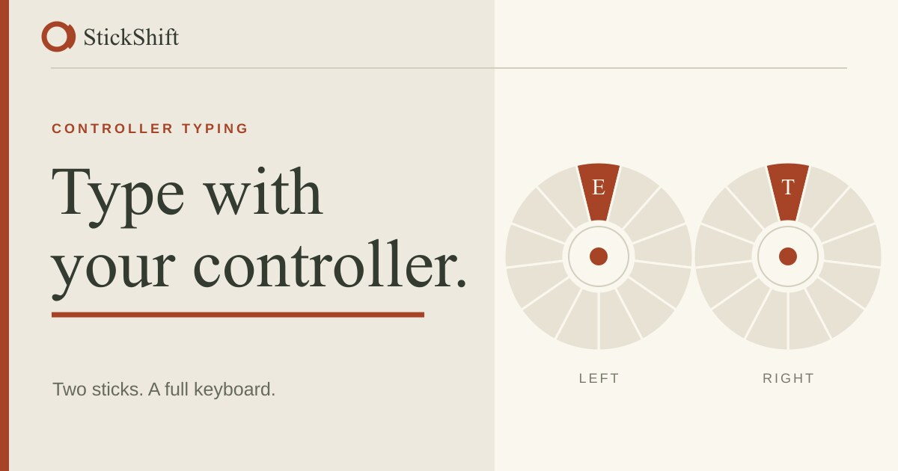

# StickShift

StickShift lets you type with a controller. Each stick points at a character on its own dial; releasing the stick enters that character. The web app has a practice area, timed tests, controller setup, and diagnostics. The desktop app can send typed characters to other programs.



## Start the web app

From the project directory:

```sh
npm install
npm run dev
```

Open the address printed by Vite, then connect a controller. Its name appears at the top of the page. If you connect more than one, use the controller selector there to choose one. The dials remain visible when no controller is connected.

Use the Theme menu in the header to choose StickShift, Xbox, PlayStation, or Switch colors in light or dark mode. The menu changes colors; controller labels and icons still refer to physical positions. Your choice is saved in this browser.

## Set up a controller

A controller that has not been set up opens the setup dialog when it connects. You can also open **Customize** and choose **Set up controller** later.

1. Try the live controller diagram. If a control lights up in the wrong place, choose **Set up**.
2. Release the sticks, triggers, and buttons. Start the resting measurement and leave the controller untouched for two seconds.
3. Follow each prompt. Hold a requested button for about one second, then release it. For a stick, push it in each requested direction and finish with a slow circle. The highlighted area shows which control to use.
4. Test the finished mapping on the live diagram. Choose **Good, save controller** if every control lights up in the right place, or **Redo setup** if something is wrong. **Edit individual controls** lets you recapture a control without repeating the whole walk through.

The prompts identify physical positions rather than assuming a particular brand's button names. A stick needs all four directions before its mapping can be saved. A button you do not have can be skipped.

## Type and edit

Move either stick toward a character and return it to center to enter it. The layer controls above the dials switch between lowercase, uppercase, numbers, and symbols. Press a stick while it is held to cancel its pending character. The **Input settings** slider in the left sidebar adjusts how far a stick must move before it selects a character.

In **Practice**, the writing area accepts controller input. The D-pad moves the caret; the mapped Space, Backspace, and Enter buttons edit the text. The left sidebar shows what the currently mapped buttons do. Holding an editing button or D-pad direction repeats its action.

Suggestions appear above the dials as you type. Press the mapped Autocomplete button to select a suggestion, use the D-pad to move through the list, then press the mapped Enter button to insert it. Press Autocomplete again to leave the list. By default, Enter also accepts the first suggestion directly when the list is closed. You can change that binding in Customize.

## Pages

- **Practice** is a controller-only writing area.
- **Speed test** gives you a sentence to type with both dials. The timer starts with your first character and stops on an exact match, Submit, or the two-minute limit. Autocomplete is off during the test.
- **Head to head** uses the same sentence twice: first with a one-stick on-screen keyboard, then with both dials. On the keyboard, move with the left stick and press the mapped Enter button to choose a key.
- **Customize** edits dial layers, character positions, and button bindings. It also opens controller setup. Changes save automatically in this browser.
- **Diagnostics** shows raw controller readings and dial behavior. Use it when an input does not respond as expected.

The mapped Submit button cycles pages outside timed runs and submits a timed run. **Reset to defaults** in Customize restores the default dial layout and button bindings after confirmation.

## Desktop app

The desktop app supports Linux, Windows, and macOS. It shows the dials and sends controller typing to the application with keyboard focus. See the [desktop setup and use guide](desktop/README.md) for installation and platform requirements. macOS support has automated tests but has not been tested with a physical controller on a Mac.

## Saved settings and troubleshooting

The website saves dial layouts, button bindings, and controller profiles in your browser's local storage. Profiles are associated with the controller ID reported by the browser. Clearing site data removes those saved settings. The desktop app saves its controller profiles separately; its guide lists the location for each operating system.

If the page still says **Connect a controller**, press a button on the connected controller and check that your browser can see it. If the controller appears but a control lights up in the wrong place, reopen setup from Customize. Use Diagnostics to check whether the browser reports that input at all.

## Development and credits

Run `npm run check` for type checking, linting, formatting, tests, and both production builds. The builds place minified JavaScript and CSS in `dist/` and `dist-desktop/`.

The controller wireframe is adapted from a [CC0 diagram by TheHoodieGuy02](https://opengameart.org/content/8th-gen-console-vector-gamepad-collection). See [asset attribution](public/assets/img/gamepads/ATTRIBUTION.md).
